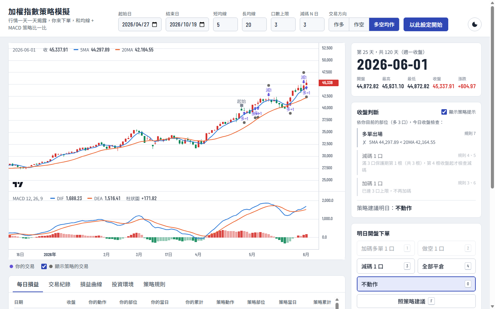

# 加權指數策略模擬

> A day-by-day trading replay game on the Taiwan Capitalization Weighted Stock Index (TAIEX).
> Historical bars are revealed one day at a time; you place orders for the next open and compete
> against a rule-based moving-average + MACD scaling strategy running in the background.
> Pure front-end (vanilla JavaScript), no build step, deployable on GitHub Pages.

**線上試玩：** https://alvinchungtw.github.io/taiex-macd-game/



以臺灣加權指數的歷史日線，一天一天揭露行情。每天收盤後，你決定隔天開盤要做多、做空、加碼、減碼或平倉。系統同時讓一套「均線 + MACD 加減碼策略」用同樣的參數自動交易，最後比較你和策略誰賺得多。

## 玩法

1. 在上方選擇起始日、結束日，並視需要調整短均線、長均線、口數上限、減碼判斷天數與交易方向（作多／作空／多空均作），按「以此設定開始」。
2. 畫面停在起始日收盤。右側的「收盤判斷」逐條列出策略規則今天是否成立，以及策略建議的明日動作。
3. 選擇明日動作，按「下一天」。隔天以開盤價成交，再以收盤價計算當日損益。
4. 到結束日時顯示結算：總損益、已實現／未實現、交易次數、勝率與最大回撤，玩家與策略並列比較。

| 快捷鍵 | 功能 |
|---|---|
| `→`、空白鍵 | 下一天 |
| `←` | 上一天（可反悔） |
| `1` `2` `3` `4` `0` | 做多／做空／減碼／全部平倉／不動作 |
| `F` | 照策略建議 |
| `H` | 顯示或隱藏策略提示（盲玩模式） |

## 策略規則

每天收盤後判斷，隔日開盤成交。以下以預設參數（5MA、20MA、上限 3 口、減碼 3 日）說明，多單為例，空單全部相反。

1. 同時間最多持有 3 口，多單、空單都做（同一時間只持有單一方向）。
2. **進場**：5MA 在 20MA 之上，且 MACD 柱狀圖大於昨日 → 隔日做多 1 口。
3. **加碼**：持有多單且未滿 3 口，柱狀圖大於前一日 → 隔日加碼 1 口。
4. **減碼**：加到第 3 口的那根 K 棒算第 1 根，前 3 根為保護期、不檢查減碼；第 4 根收盤起，柱狀圖未突破前 3 日最高值 → 隔日減碼 1 口（先平最早進場的一口）。所以滿 3 口後至少持有 4 根 K 棒。
5. 未滿 3 口不減碼。
6. 減碼後若符合加碼條件，照樣再加碼；再次加到 3 口時，保護期重新計算。
7. **出場**：5MA 跌破 20MA → 隔日全部平倉。
8. 空單規則與多單相反。
9. 出場當日即使符合反向進場條件，也只平倉、不反手，隔日收盤再重新判斷。

同一天有多個訊號時，優先序為出場 > 減碼 > 加碼。MACD 參數固定為 12 / 26 / 9，柱狀圖 = DIF − DEA。

## 投資環境

- **標的**：臺灣加權股價指數（TAIEX），直接使用指數點位，不是台指期價格，所以沒有期現貨價差與轉倉問題。
- **點值**：1 點 = 1 元，損益 = 點數變化 × 口數。
- **交易成本**：不包含手續費、稅費，也不計滑價。
- **成交方式**：只用每日收盤價判斷，符合條件時次日以開盤價成交。
- **交易方向**：可選作多、作空或多空均作，玩家與策略都只能做開放的方向。
- **資金**：不考慮本金與保證金，部位大小只受口數上限限制。
- **未平倉部位**：每天以收盤價計算未實現損益，結束日以最後收盤價結算。

## 技術重點

- **策略引擎與畫面分離**：指標計算（`indicators.js`）、規則判斷（`strategy.js`）、帳戶與遊戲流程（`game.js`）都是不依賴 DOM 的純邏輯，畫面（`ui.js`）只負責呈現。
- **單元測試**：以 Node.js 內建的 `node:test` 測試各條規則、先進先出減碼的損益，以及「玩家完全照策略操作時，結果必須與策略對照組一致」。
- **不偷看未來**：圖表只畫到當天，指標使用起始日之前的歷史資料暖機，避免第一天的均線與 MACD 失真。
- **零建置、可離線**：不需要打包工具；圖表函式庫放在 `vendor/`，直接點開 `index.html` 也能玩。
- **安全的輸出方式**：所有動態文字都用 `textContent` 輸出，使用者輸入的參數都會做範圍驗證。

## 專案結構

```
taiex-macd-game/
├── index.html
├── css/style.css
├── js/
│   ├── indicators.js   均線、EMA、MACD
│   ├── strategy.js     策略規則引擎
│   ├── game.js         帳戶（FIFO 部位）與遊戲流程
│   └── ui.js           圖表、面板、快捷鍵
├── data/taiex_data.js  加權指數日線資料（由 tools/export_taiex.py 產生）
├── tools/export_taiex.py
├── tests/strategy.test.js
└── vendor/lightweight-charts/
```

## 本機執行

直接用瀏覽器開啟 `index.html` 即可，不需要架設伺服器。

執行測試（需要 Node.js 18 以上）：

```bash
npm test
```

## 更新行情資料

資料來自本機的 SQLite 資料庫（`TAIEX` 資料表，欄位含 `id`、`open`、`high`、`low`、`close`）。資料庫不放進這個 repo，更新後執行：

```bash
py tools/export_taiex.py <stock.db 的路徑>
```

會重新產生 `data/taiex_data.js`，提交後 GitHub Pages 會自動更新。

## 部署到 GitHub Pages

在 repo 的 **Settings → Pages** 中，Source 選擇 `Deploy from a branch`，分支選 `main`、資料夾選 `/ (root)`，儲存後約一分鐘即可透過上方網址開啟。

## 資料來源與授權

- 本專案程式碼以 [MIT License](LICENSE) 授權。
- 行情資料：臺灣證券交易所公開的加權指數日線資料。
- 圖表：[TradingView Lightweight Charts™](https://www.tradingview.com/)（Apache License 2.0），授權與聲明見 `vendor/lightweight-charts/`。

## 免責聲明

本專案僅供教學與展示，回測與模擬結果不代表未來績效，不構成任何投資建議。
